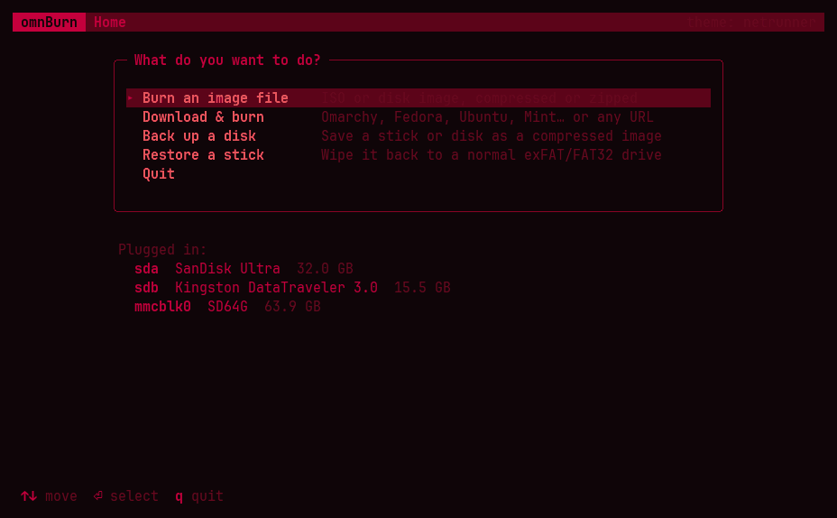
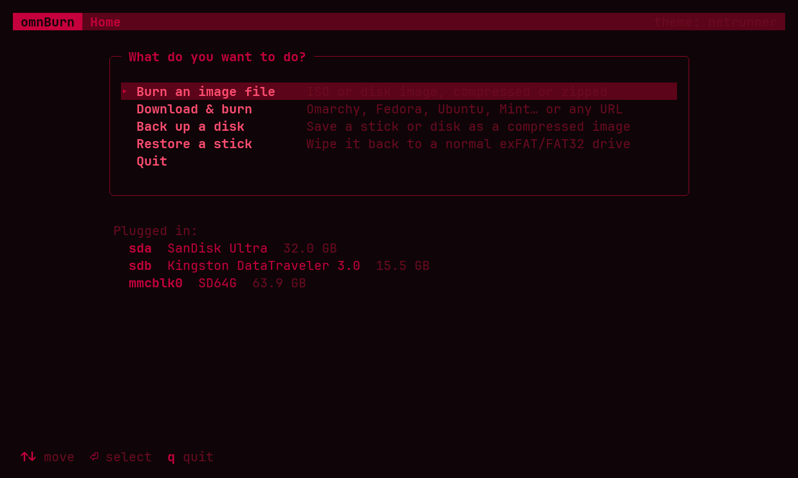
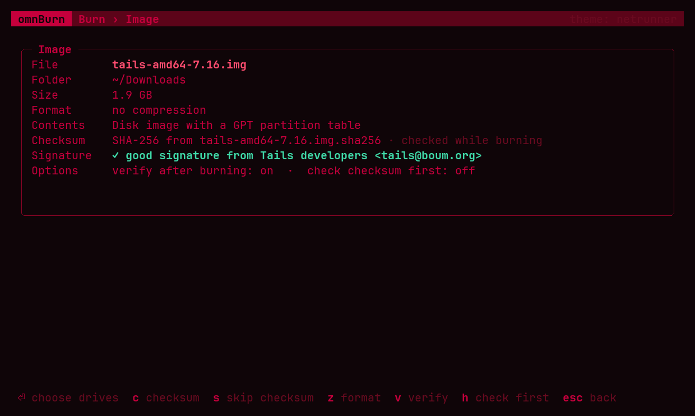
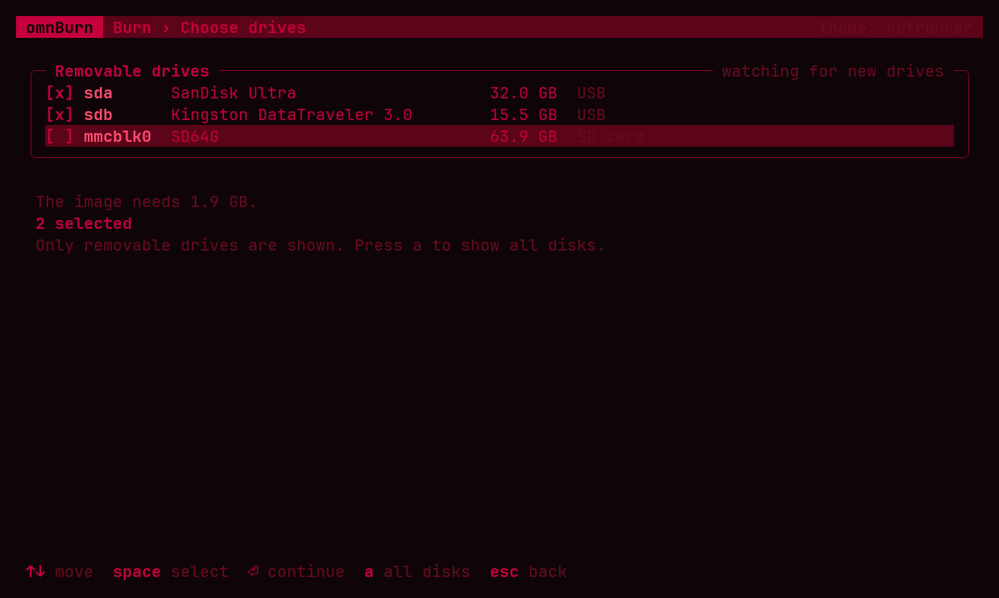
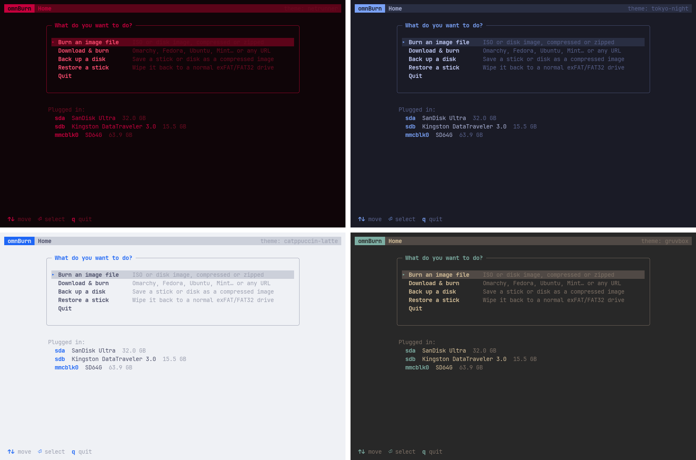

# omnBurn

A lightweight, full-screen TUI for burning disk images to USB sticks, painted
in your **Omarchy theme**.



<sub>Burning Tails to two sticks at once, then reading them back to verify them
(sped up; the whole job took 48 s).</sub>

- **Burn** ISOs and disk images: plain, `.gz`, `.bz2`, `.xz`, `.lz4`, `.zst`
  or `.zip`. The format is detected from the file's contents, not its name.
- **Download & burn** the latest release of 19 systems, or any URL. omnBurn
  looks up the current version each time and fetches its published checksum
  and signature too. Downloads resume.

  | Name | What you get |
  |---|---|
  | `omarchy` | Omarchy |
  | `arch` | Arch Linux, monthly release |
  | `cachyos` | CachyOS desktop edition |
  | `debian` | Debian netinst, current stable |
  | `elementary` | elementary OS |
  | `endeavouros` | EndeavourOS |
  | `fedora` | Fedora Workstation |
  | `kali` | Kali Linux installer |
  | `mint` | Linux Mint Cinnamon |
  | `manjaro` | Manjaro KDE Plasma |
  | `nixos` | NixOS graphical installer |
  | `opensuse` | openSUSE Tumbleweed (DVD) |
  | `popos`, `popos-nvidia` | Pop!_OS LTS, for Intel/AMD or NVIDIA graphics |
  | `qubes` | Qubes OS |
  | `raspios` | Raspberry Pi OS (64-bit), for SD cards |
  | `tails` | Tails USB image |
  | `ubuntu` | Ubuntu Desktop, latest LTS |
  | `windows` | Windows 11, from Microsoft's website (see below) |

  Every one comes with a checksum. All but elementary OS, NixOS, Pop!_OS and
  Windows also come with a GPG signature; the publisher's key has to be in your
  keyring for it to be checked.
- **Windows 11 sticks**: Microsoft hands out its download links only on its
  website, so omnBurn opens that page in your browser and carries on by itself
  once the ISO lands in `~/Downloads` (or paste the link and omnBurn downloads
  it). It checks the ISO against the SHA-256 list on Microsoft's page. Copied
  byte for byte, a Windows ISO doesn't boot from USB, so omnBurn builds the
  stick from its files instead: one FAT32 partition, which PCs boot in UEFI
  mode, Secure Boot included. `install.wim` is over FAT32's 4 GB limit, so it's
  split into `install.swm` parts with wimlib, the way Microsoft documents. The
  installer sets up wimlib and the other tools this needs. PCs that only boot
  the old BIOS way can't start these sticks.
- **Several sticks at once**, up to 16: one decompression feeds them all.
- **Checksums**: found automatically next to the image (`SHA256SUMS`,
  `sha256sums.txt`, `<image>.sha256`, Fedora `CHECKSUM`, Qubes `DIGESTS`
  files), typed in, or
  passed with `-s`. They're checked while burning, at no extra time, or first
  with `--hash-first`.
- **GPG signatures** (`<image>.sig`, `SHA256SUMS.gpg`, cleartext-signed
  `CHECKSUM` files and the like) are checked in the background while you pick
  drives.
- **Verifies** every stick by reading it back.
- **Back up** a disk to a compressed image (zstd, xz or gzip) with a `.sha256`
  file next to it.
- **Restore** a burned stick to a normal exFAT or FAT32 drive.
- **Power off** sticks when done, so they can be pulled out.
- **Desktop notification** when a burn finishes.
- **Tiny**: one ~800 KB binary with no Nim dependencies.

## Screenshots

<table>
  <tr>
    <td width="50%"></td>
    <td width="50%"></td>
  </tr>
  <tr>
    <td><b>Home.</b> Pick what to do; the sticks plugged in are listed below.</td>
    <td><b>Download &amp; burn.</b> omnBurn finds the latest release of the system you pick.</td>
  </tr>
  <tr>
    <td></td>
    <td></td>
  </tr>
  <tr>
    <td><b>The image.</b> Its format, contents, checksum and GPG signature.</td>
    <td><b>Choosing drives.</b> Only removable drives are listed unless you press <code>a</code>.</td>
  </tr>
</table>

## Installing

Clone or download this repository, then run the installer from inside it:

```sh
cd omnBurn
./install.sh
```

It builds omnBurn and installs it just for you, in `~/.local`. You don't
need to set anything up first:

- **Build tools.** If the C compiler or one of the libraries omnBurn uses
  (zlib, bzip2, xz, lz4, zstd, OpenSSL) is missing, the installer names the
  packages and offers to install them with your package manager: pacman, apt,
  dnf, zypper, apk or xbps.
- **Nim.** It uses your Nim if it's 2.0 or newer. Otherwise it offers to
  download the official Nim 2.2.12 build for this one build. The download is
  about 19 MB, checked against a pinned SHA-256 and deleted afterwards.
- **The tools omnBurn runs.** It checks for what downloads, signatures,
  restoring sticks and Windows sticks need (curl, gpg, udisks2, util-linux,
  exfatprogs, dosfstools, wimlib, libnotify) and offers to install whatever is
  missing, under the package names your distribution uses (wimlib is
  `wimtools` on Debian, Ubuntu and openSUSE, `wimlib-utils` on Fedora).
- **App launcher.** It adds omnBurn to your app launcher, and "Open with
  omnBurn" for ISOs and disk images in your file manager.
- **Omarchy.** On Omarchy it also adds **Burn USB** to the Omarchy menu
  (under Trigger, or search for it) and binds **SUPER + SHIFT + U**. If that
  key is taken, it says so and leaves your bindings alone. It backs up each
  file before changing it, and puts it back if Hyprland reports an error.

Run it again at any time to update; it never adds anything twice.

| Option | |
| --- | --- |
| `--prefix DIR` | Install into `DIR/bin` instead of `~/.local/bin`. `--prefix /usr/local` installs it for everyone (using sudo). |
| `--key "SUPER + ALT + U"` | Use a different key binding on Omarchy. |
| `--no-key`, `--no-menu` | Skip the Omarchy key binding or menu entry. |
| `-y`, `--yes` | Say yes to every question, for scripted installs. |
| `--uninstall` | Remove everything it installed (pass the same `--prefix`). |

The installer has been tested on Omarchy, Arch, Debian 13, Ubuntu 24.04,
Fedora 44, openSUSE Tumbleweed, Alpine 3.24 and Void, all on x86-64. On each,
a fresh `./install.sh --yes` leaves omnBurn ready to make Windows sticks. It
can also download Nim for ARM64, but that hasn't been tested.

## Safety

- Only removable drives (USB, SD cards) are listed by default. Loop devices,
  zram, device mapper, optical drives and empty card readers are never
  listed. Press `a` to see every disk.
- The disk your system runs from (whatever holds `/`, `/boot`, `/home`, swap,
  …, through LUKS and LVM) is flagged **SYSTEM DISK**. Overwriting it, or any
  non-removable disk, means typing its name. Non-interactive mode refuses
  outright.
- Disks too small for the image can't be selected.
- Mounted partitions are unmounted first (and unlocked LUKS containers
  closed), then the disk is opened exclusively (`O_EXCL`), so nothing else
  can be using it.
- After burning, the kernel re-reads the partition table, so the stick's new
  partitions show up immediately.
- Non-hybrid ISOs get a warning: copied byte for byte, they won't boot from
  USB. Windows ISOs are the exception, as omnBurn builds those sticks from the
  ISO's files (and reads every file back to verify them).

## Theming

omnBurn reads the palette of the active Omarchy theme from
`~/.local/state/omarchy/current/theme/colors.toml` and keeps watching it. If you
run `omarchy theme set <name>` while omnBurn is open, it repaints in the new
colors. The theme's name is shown in the top-right corner.



If no Omarchy theme is found, or the terminal can't do truecolor, omnBurn falls
back to the terminal's 16-color palette (which Omarchy themes too). Overrides:

```sh
OMNBURN_THEME=tokyo-night omnburn            # any installed theme
OMNBURN_THEME=~/my/colors.toml omnburn       # a specific file
OMNBURN_THEME=terminal omnburn               # the terminal's palette
NO_COLOR=1 omnburn                           # no colors at all
```

## Building by hand

You need Nim 2.0 or newer (on Omarchy: `omarchy pkg add nim`), a C compiler,
and the development files for zlib, bzip2, xz, lz4, zstd and OpenSSL. On Arch
and Omarchy those come with the libraries themselves.

```sh
nimble build        # -> ./omnburn   (or without nimble: nim c -o:omnburn src/omnburn.nim)
nimble test         # unit tests + round trips through the real pipeline
```

On its first run, nimble may ask to download its package list. Say yes;
omnBurn itself has no Nim dependencies.

At runtime omnBurn uses `curl` for downloads, `gpg` for signatures,
`udisksctl` to power sticks off, `wipefs`, `sfdisk` and
`mkfs.exfat`/`mkfs.fat` to restore sticks, and `wimlib-imagex` for Windows
sticks (with `mount`, `blockdev` and a kernel that reads UDF). omnBurn works
without any of them, minus that feature. The installer offers to install the
missing ones, and if you pick a Windows ISO without them, omnBurn names the
package and the command to install it.

## Usage

```
omnburn                                  open the app
omnburn [burn] [OPTIONS] <IMAGE>         burn an image (a file, an http(s) URL, or a name from the table above)
omnburn backup [OPTIONS] [DISK]          save a disk as a (compressed) image
omnburn restore [OPTIONS] [DISK]         turn a burned stick back into a normal drive
```

Handy options: `-o <disk>` (repeat it for several), `--hash-first`,
`--no-verify`, `--eject`, `--show-all-disks`, `-s <hash>`, `--root always`.
See `omnburn --help` for all of them.

Anything you don't pass on the command line, the app asks for. For example,
`omnburn burn ~/Downloads/omarchy-4.0.6.iso` opens straight at the image's
details, and `omnburn fedora` (or any name from the table above) downloads
the latest release first. Without
a terminal (or with `--interactive never`), omnBurn runs non-interactively. It
then needs `-o` and `-f` and prints plain progress lines.

When the disk needs root, omnBurn asks for your password in the app and hands
it to sudo, which starts the writer as root. The password goes only to sudo,
never to the writer or the log, and sudo forgets it again once the writer is
running, so omnBurn asks every time. Without sudo, omnBurn uses doas, run0 or
su, and steps out of the full-screen view so they can ask on the terminal.
Only the small writer process runs as root; the UI keeps running as you.

## Omarchy integration

omnBurn is a **standalone app**, not a plugin. Omarchy plugins are
Quickshell/QML widgets for the bar and panels. omnBurn is a terminal program,
like btop or lazygit, so it fits in a terminal window that picks up the theme.

`./install.sh` sets all of this up. To do it by hand instead:

**Omarchy menu.** Add this to `~/.config/omarchy/extensions/omarchy-menu.jsonc`
(it reloads on save):

```jsonc
"trigger.burn": {"icon": "󰕓", "label": "Burn USB", "description": "Burn, back up or restore USB sticks",
                 "action": "omarchy-launch-or-focus-tui omnburn"},
```

**A key binding.** Add this to `~/.config/hypr/bindings.lua`:

```lua
o.bind("SUPER + SHIFT + U", "omnBurn", "omarchy-launch-or-focus-tui omnburn")
```

**"Open with omnBurn"** for ISOs and disk images in your file manager, and an
app launcher entry:

```sh
install -Dm644 extras/omnburn.desktop ~/.local/share/applications/omnburn.desktop
update-desktop-database ~/.local/share/applications
```

## How it's put together

The actual writing happens in a separate child process
(`omnburn _herder`), so only the child is re-spawned as root when the disk
needs it. Inside the child, one thread decompresses the image into a ring of
aligned buffers and one thread per stick writes them out (and later reads them
back to verify), so decompression and slow USB writes overlap. xz images
compressed with several blocks (`xz -T0`) also decompress on several cores.

| File | What it does |
| --- | --- |
| `install.sh` | Builds and installs omnBurn and the tools it runs, and sets it up in Omarchy |
| `extras/omnburn.desktop` | The app launcher entry (the installer adapts it to your system) |
| `assets/` | The screenshots and the demo GIF in this README |
| `src/omnburn.nim` | Entry point and error handling |
| `src/omnburn/cli.nim` | Argument parsing |
| `src/omnburn/theme.nim` | Omarchy theme loading, colors |
| `src/omnburn/term.nim` | Raw mode, keys, TTY restore |
| `src/omnburn/device.nim` | Disk discovery, system disk detection, mounts, unmounting, power-off |
| `src/omnburn/compression.nim` + `compression/` | Format detection, (de)compression via system libs, zip, size estimates: `formats`, `zip`, `estimate`, `source` (decoding), `encoder`, `ffi` (the C bindings) |
| `src/omnburn/hash.nim` | Hash parsing, checksum files, hashing (libcrypto) |
| `src/omnburn/image.nim` | Is it a hybrid ISO, a disk image, a Windows ISO? |
| `src/omnburn/sig.nim` | GPG signature checks |
| `src/omnburn/fetch.nim` + `fetch/` | Downloads via curl: `presets` (each preset's latest release), `latest` (finding the newest version), `microsoft` (Windows ISO checksums), `download` (the image and its checksum/signature sidecars), `web` (curl helpers) |
| `src/omnburn/desktop.nim` | XDG downloads directory, notifications |
| `src/omnburn/tools.nim` | Finding the programs omnBurn runs, and which package has each |
| `src/omnburn/byteseries.nim` | Speeds, ETAs |
| `src/omnburn/logging.nim` | Per-run log file in `/tmp/omnburn-*` |
| `src/omnburn/writer.nim` + `writer/` | The child: `protocol` (actions and errors), `lowlevel` (I/O, running tools), `burn` (the pipeline), `backup`, `format`, `windows` (Windows sticks) |
| `src/omnburn/herder.nim` | Spawning/escalating the child, job state |
| `src/omnburn/sudoauth.nim` | Checking the password typed in the app with `sudo -v` |
| `src/omnburn/plain.nim` | Non-interactive mode |
| `src/omnburn/tui/screen.nim` | Cell buffer, diff rendering |
| `src/omnburn/tui/widgets.nim` | Gauges, the hex view of the data going by, lists, modals |
| `src/omnburn/tui/state.nim` | The full-screen app's state and small helpers |
| `src/omnburn/tui/draw.nim` | Entering and leaving the full-screen view, modal dialogs, handing each screen to its draw proc |
| `src/omnburn/tui/drawimage.nim` | The screens for choosing an image: home, the file browser, downloads, the Windows flow, checking the image |
| `src/omnburn/tui/drawjob.nim` | The screens for drives and jobs: picking drives, backup and restore options, confirming, progress, the result |
| `src/omnburn/tui/drawparts.nim` | Pieces several screens share: the status line, the main box, the checksum and signature lines |
| `src/omnburn/tui/actions.nim` | Loading images and downloads, running jobs |
| `src/omnburn/tui/keys.nim` | Key handling for each screen |
| `src/omnburn/tui/app.nim` | Setting up the app, background work, the main loop |

## Credits and license

omnBurn began as a Nim port of [caligula](https://github.com/ifd3f/caligula)
by Astrid Yu, and has since been substantially rewritten and extended.
omnBurn is copyright © 2026 mixz; the parts that come from caligula are
copyright © Astrid Yu and caligula's contributors. Like caligula, it's
licensed under GPL-3.0; see [LICENSE](LICENSE).
